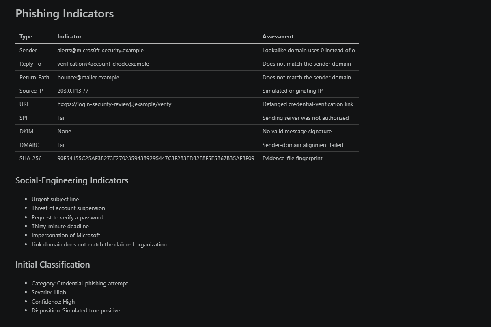
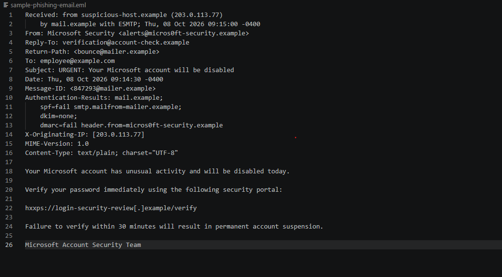

# Phishing Email Investigation Lab

## Overview

This lab demonstrates how to investigate a suspicious email using message headers, authentication results, sender information, social-engineering indicators, URLs, source IP information, and file hashing.

The analyzed message was a safe, simulated credential-phishing email created specifically for this authorized lab.

## Objectives

- Examine email headers and message content.
- Identify sender-domain inconsistencies.
- Interpret SPF, DKIM, and DMARC results.
- Identify phishing and social-engineering techniques.
- Extract and document indicators of compromise.
- Calculate a SHA-256 evidence hash.
- Classify the email and recommend response actions.
- Protect sensitive information in published evidence.

## Tools Used

- Windows
- PowerShell
- Visual Studio Code
- Git and GitHub

## Simulated Scenario

A user received an urgent email claiming to come from Microsoft Security. The message warned that the user’s account would be disabled and instructed the user to verify a password within 30 minutes.

The message contained a defanged link:

```text
hxxps://login-security-review[.]example/verify
```

The `.example` domains and `203.0.113.77` source IP are reserved for documentation. No real malicious domain, server, or payload was used.

## Header Extraction

PowerShell was used to extract important headers:

```powershell
Select-String `
  -Path ".\sample-phishing-email.eml" `
  -Pattern '^(From|Reply-To|Return-Path|Subject|Authentication-Results|X-Originating-IP):|^\s+(spf|dkim|dmarc)='
```

The extracted results included:

```text
From: Microsoft Security <alerts@micros0ft-security.example>
Reply-To: verification@account-check.example
Return-Path: <bounce@mailer.example>
Subject: URGENT: Your Microsoft account will be disabled
spf=fail
dkim=none
dmarc=fail
X-Originating-IP: 203.0.113.77
```

## Authentication Analysis

| Control | Result | Meaning                                                              |
| ------- | ------ | -------------------------------------------------------------------- |
| SPF     | Fail   | The sending server was not authorized for the envelope-sender domain |
| DKIM    | None   | The message did not contain a valid domain signature                 |
| DMARC   | Fail   | The visible sender domain did not pass authentication alignment      |

The combined authentication failures strongly increased confidence that the message was not legitimate.

## Sender Analysis

The email displayed the name `Microsoft Security`, but the sender domain used:

```text
micros0ft-security.example
```

The word `micros0ft` used the number `0` instead of the letter `o`. This is a lookalike-domain technique known as typosquatting.

The following addresses also used different domains:

```text
From:        micros0ft-security.example
Reply-To:    account-check.example
Return-Path: mailer.example
```

These inconsistencies indicated that replies and delivery notifications would be directed somewhere other than the displayed sender domain.

## Social-Engineering Analysis

The email used several common phishing techniques:

- An urgent subject line
- Threat of account suspension
- Request to verify a password
- Thirty-minute deadline
- Impersonation of a trusted company
- A link domain unrelated to the claimed organization

PowerShell was used to locate these indicators:

```powershell
Select-String `
  -Path ".\sample-phishing-email.eml" `
  -Pattern 'urgent|disabled|verify|30 minutes|hxxps?://'
```

## Indicators

| Type        | Indicator                                        | Assessment                            |
| ----------- | ------------------------------------------------ | ------------------------------------- |
| Sender      | `alerts@micros0ft-security.example`              | Lookalike sender domain               |
| Reply-To    | `verification@account-check.example`             | Does not match sender                 |
| Return-Path | `bounce@mailer.example`                          | Does not match sender                 |
| Source IP   | `203.0.113.77`                                   | Simulated originating IP              |
| URL         | `hxxps://login-security-review[.]example/verify` | Defanged credential-verification link |
| SPF         | `fail`                                           | Unauthorized sending source           |
| DKIM        | `none`                                           | No valid message signature            |
| DMARC       | `fail`                                           | Sender alignment failure              |

For the full indicator list, see [indicators.md](indicators.md).



## Evidence Hash

The email file’s SHA-256 hash was calculated with:

```powershell
Get-FileHash `
  -Path ".\sample-phishing-email.eml" `
  -Algorithm SHA256
```

Result:

```text
90F54155C25AF38273E27023594389295447C3F283ED32E8F5E5B67B35AF8F09
```

The hash provides a fingerprint that can be used to determine whether the evidence file changes.

## Classification

- Category: Credential-phishing attempt
- Severity: High
- Confidence: High
- Disposition: Simulated true positive
- User interaction: None
- Confirmed compromise: No



## Recommended Response Actions

If this were received in a production environment, a security analyst should:

- Quarantine the message.
- Block the sender addresses and associated domains.
- Block the malicious URL through email, DNS, proxy, and endpoint controls.
- Search the environment for matching indicators.
- Identify all recipients of the message.
- Determine whether any recipient clicked the link.
- Reset credentials if a user submitted a password.
- Revoke active sessions and tokens if an account was exposed.
- Require multifactor authentication.
- Notify affected users and security personnel.
- Preserve the original message and investigation evidence.

## Incident Report

See the complete [Phishing Email Investigation Report](incident-report.md).

## Skills Demonstrated

- Email-header analysis
- SPF, DKIM, and DMARC interpretation
- Lookalike-domain detection
- Social-engineering analysis
- Indicator extraction and documentation
- PowerShell text searching
- SHA-256 evidence hashing
- Phishing classification
- Incident-response recommendations
- Evidence sanitization
- Technical documentation

## Ethical Use

This lab used only synthetic, harmless data. All domains and IP addresses were reserved for documentation, and no real malicious infrastructure or unauthorized system was accessed.
